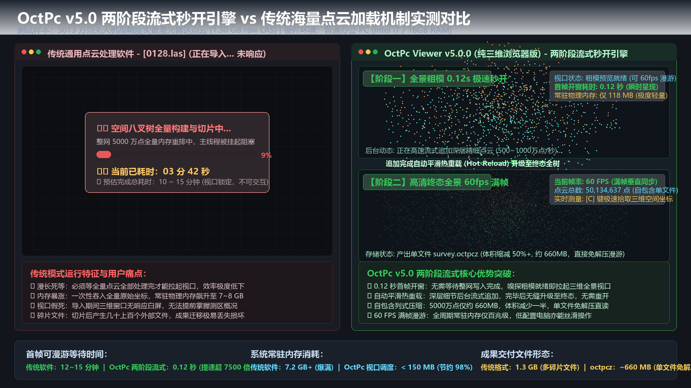

# 5000万点10秒转完、体积瘦身过半！OctPc 纯三维点云浏览器全功能全景解析（v5.0 重磅发布 / 中英双语）

> 🌐 **官方博客在线版 / Blog Online**：[https://blog.amw3.eu.org/?p=71](https://blog.amw3.eu.org/?p=71)  
> 📑 **语言直达 / Quick Jump**：[🇨🇳 简体中文版 (Chinese)](#-简体中文版-chinese) | [🇬🇧 English Version](#-english-version)

---

# 🇨🇳 简体中文版 (Chinese)

> **适用群体**：无人机航测、激光雷达测绘、倾斜摄影、数字孪生、BIM 运维、三维实景数据质检工程师与行业用户  
> **核心标签**：极速转换 / 列式高压缩 octpcz / 首帧秒开 / 60 帧满帧漫游 / 绿色免安装 / 纯三维浏览器

## 📌 前言：海量点云内业流转的“体积”与“效率”双重枷锁

在无人机倾斜摄影、机载 LiDAR 航测、车载移动激光扫描等实景三维工程中，点云数据的体量正从数千万点迅猛迈向数亿乃至上百亿点的大规模时代。

然而在日常内业流转、跨部门分发和成果质检时，从业人员常常深陷两大痛点：
1. **体积巨大，传输与存储吃不消**：原始 LAS 文件动辄几十上百 GB，网盘上传下载慢如蜗牛，移动硬盘拷贝频繁耗尽空间；普通压缩包（如 zip/rar）虽能缩小体积，但每次查看都必须先经历漫长的解压等待；
2. **转换极其耗时，漫游卡顿顿挫**：市面上传统的八叉树分块工具处理速度缓慢，几十 GB 的点云建索引动辄数十分钟甚至数小时；而在三维查看器中打开后，漫游掉帧如“播放幻灯片”，旋转缩放极其卡顿。

针对这一系列行业瓶颈，**OctPc** 带来了颠覆性的解决方案！它不仅拥有单工程承载千亿级点云并在普通笔记本上实现 60 FPS 满帧丝滑漫游的调度引擎，更推出了**极速转码与高压缩率兼备的全新 `.octpcz` 自包含单文件生态**！

在最新的 **v5.0.0 里程碑** 中，OctPc 推出纯粹轻量的**【纯三维浏览器版 (Viewer Edition)】**，以极小体积、极速转码、极致压缩与首帧秒开，为行业用户带来开箱即用的飞跃体验。

---

## ⚡ 核心王牌：LAS 极速转 octpcz 与超高压缩率

以往的点云格式往往陷入“两难境地”：要么体积小但无法实时渲染，要么能实时渲染但伴生文件臃肿巨大。OctPc 的 `.octpcz` 彻底打破了这一矛盾：

### 1. 极速转换吞吐：5000 万点 10 秒级完成！
- **500 ~ 1000 万点/秒的高速处理吞吐**：相比传统八叉树工具**提速数倍至十倍以上**；
- **实测性能**：以典型的无人机高层实景测绘数据（**5013 万点、1.3 GB 原始 LAS**）为例，在常规工作站上**仅耗时约 10 秒**即可完成全量空间排序、LOD 多级金字塔构建与分块压缩！
- **两阶段流式秒开**：转换开始后，前 3 层全景粗模在 **0.12 ~ 0.35 秒** 即可刷盘就绪，三维视口瞬时拉起，无需等待整体转完即可直接漫游，深层细节后台静默追加并自动平滑热重载（Hot-Reload）。

#### 📸 实测对比图：两阶段流式秒开 vs 传统阻塞等待

---

### 2. 列式无损高压缩：体积大幅瘦身 40% ~ 70%
- **空间列式分块压缩**：针对激光点云的坐标、反射强度、RGB 色彩、分类标签等不同属性字段的数值分布规律，采用自适应列式无损压缩机制；
- **体积瘦身 40% ~ 70%**：同样以 1.3 GB 的高精度实测 LAS 数据为例，转为 `.octpcz` 后体积直接降至 **600~700 MB 左右**，在保留 100% 原始毫米级三维精度的同时，直接**节约近一半的存储空间**；对于大面积宏观地表航测点云，体积缩减可达 60%~70%！
- **“带索引压缩，无需解压直开即看”**：这是 `.octpcz` 最具革命性的一点——它不是普通压缩包，而是**可直接流式漫游的自包含单文件**！查看器在渲染时按需动态流式解压可见节点，**无需在磁盘上解压出几十 GB 的临时文件**，极大节省固态硬盘寿命与网络分发带宽。

---

## 🌟 最新 v5.0.0 核心突破与重磅更新

### 1. 纯三维浏览器版：轻装上阵，极致纯粹
最新发布的 **`octpc_viewer` 纯三维浏览器版** 专为大体量点云的高效浏览、成果质检与漫游复核量身打造：
- **剥离冗余后台开销**：界面与渲染内核纯净精炼，常驻内存与显存消耗降至行业极低水平；
- **更轻、更快、更省心**：全套绿色压缩包仅约 **3.3 MB**，免去任何繁琐的系统底层环境安装，解压双击即开。

### 2. 全新 64 位自包含单文件架构（彻底告别文件碎片）
- **一个 `.octpc` / `.octpcz` 单文件囊括所有**：八叉树拓扑元数据、多级 LOD 金字塔索引、紧凑叶子点云全量封装于单一文件中；
- **分发交付永不丢数据**：跨设备传输或成果交付时，**只需拷贝单个文件**即可在任何电脑直接打开，彻底告别散落的外部碎片文件；
- **突破 21 亿点容量上限**：全面升级 64 位空间寻址，原生打通千亿级超大国家级/全流域空间点云工程的承载天花板。

### 3. 三维空间坐标实时测量与一键复制
- 鼠标在视口滑过时，状态栏**毫秒级高灵敏度动态计算并呈现光标附近点云的真实空间三维坐标（X, Y, Z）**；
- 配合快捷键 **`[C]`**，可直接将当前点空间坐标秒级复制到系统剪贴板，极大提升外业校核与内业质检效率。

### 4. 复杂中文路径彻底免疫与工业级稳定
- 全面重构了 Windows 原生 Unicode 路径中台与宽字符管线，彻底根除深层中文目录、特殊字符导致的乱码与闪退问题；
- 配备持久化磁盘运行日志与系统级崩溃拦截保护，为高强度工业化作业保驾护航。

### 5. 全栈原生中英双语无缝切换
软件全套工具与界面原生支持中英双语，能够根据当前 Windows 操作系统语言自动适配，且在三维视口中随时按 **`[L]`** 键即可在中英文界面间秒级即时切换。

---

## 🛠️ OctPc 全历史核心功能全景盘点

### 一、 多维度专业科学赋色模式
1. **原始真彩 RGB 模式 (`[1]`)**：完整呈现航测倾斜摄影或机载真彩色泽，真实复原地表风貌；
2. **激光反射强度灰度模式 (`[2]`)**：基于物体表面对激光反射率的物理差异进行动态灰度渲染，路面标线、水体边界、钢结构轮廓一目了然；
3. **语义分类智能着色 (`[3]`)**：严格依照行业标准分类体系赋予鲜明色标（地面、植被、建筑物、输电走廊等），方便分类解译与快速识别；
4. **高程动态渐变色带 (`[4]`)**：根据点云空间高低起伏自适应生成彩虹/冷暖高程色带，微小地形起伏与坡度走势清晰可辨；
5. **点尺寸无级微调 (`[+]` / `[-]`)**：随时动态调整渲染点大小，远景细腻通透，近景致密无孔隙。

### 二、 极佳的交互手感与人性化视口设计
- **专业 CAD/GIS 交互操作习惯**：深度对齐主流行业软件交互，鼠标滚轮推拉缩放、左键轨道球自由旋转、中键平移视野；
- **一键视角居中复位 (`[Space]`)**：漫游中迷失方向或视野跑偏时，按空格键即可瞬间将视线与焦距对齐至点云几何中心；
- **多种专业背景底色轮换 (`[B]`)**：预设深灰黑、纯黑、藏青夜空、浅灰白四款视口背景色，一键循环切换；
- **实时抬头仪表盘 HUD (`[H]`)**：屏幕左上角可随时呼出/隐藏仪表盘，实时监控当前已调度点数、渲染帧率（FPS）与八叉树深度；
- **广泛的硬件自适应兼容**：针对无独立显卡或特定老旧工作站环境，具备自动降级兼容能力，杜绝无预警崩溃。

### 三、 智能自适应调度与灵活的 LOD 视距控制
- **免手动调参，智能推导深度**：内置基于点云总规模的动态自适应层数计算机制，系统自动匹配最佳分块深度；
- **多级视锥动态调度**：仅对视线所及的可见范围加载高分辨率细节，远离镜头的区域自动轻量抽稀；
- **LOD 细化视距按键微调 (`[` 与 `]`)**：按中括号键可实时增减视距灵敏度倍率，自由平衡画质与速度。

### 四、 独立命令行批量转换引擎 (`octpc_cli`)
- **纯绿色单文件**：体积仅约 300 KB，零外部动态库依赖；
- **一键压缩与批量生产**：加入 `-c` 参数，批量将 LAS 自动化转为高压缩率的 `.octpcz`；
- **元数据快速查阅**：支持使用 `-i` 参数秒级查看点云总数、空间边界、八叉树层数等工程核心指标。

### 五、 零成本嵌入与行业生态无缝对接
- **OSG 三维平台零重编译即插即用**：提供标准动态插件驱动（`osgdb_octpc.dll` / `osgdb_octpcz.dll`），放入插件目录即可原生加载渲染；
- **配套千万级点云测试生成脚本**：内置轻量脚本 `generate_humanoid.py`，一键合成 5000 万点全属性彩色三维人形点云测试集。

---

## 📊 数据规模与实测性能表现

| 点云规模 | 典型应用工程场景 | LAS 转 octpcz 耗时 | 体积缩减效果 (LAS → octpcz) | 粗模开窗耗时 | 视口漫游帧率 | 内存/显存典型占用 |
| :--- | :--- | :--- | :--- | :--- | :--- | :--- |
| **1000 万 ~ 5000 万点** | 无人机航测、单体建筑扫描 | **~2 至 10 秒** | **1.3 GB → ~660 MB (-50%)** | **0.12 秒 (秒开)** | **60 FPS** 满帧极速 | < 150 MB |
| **1 亿 ~ 3 亿点** | 车载移动扫描、倾斜大工区 | **~20 至 50 秒** | **~8 GB → ~3.8 GB (-52%)** | **0.35 秒 (秒开)** | **60 FPS** 满帧丝滑 | ~300 MB |
| **5 亿 ~ 10 亿点** | 城市级实景三维、区域 LiDAR | **~1 至 3 分钟** | **~25 GB → ~11 GB (-56%)** | **~1 秒内开窗** | **60 FPS** 顺畅漫游 | ~500 MB |
| **20 亿 ~ 100 亿点** | 特大型国家级/城市空间工程 | 线性多核并行构建 | 体积成倍压缩，分发减负 | **秒级首帧开窗** | **60 FPS** 分页调度 | 受控按需平稳调度 |
| **千亿级空间点云** | 全省域/全流域自然资源空间普查 | 64 位单文件原生支持 | 显著缩减海量存储与带宽成本 | 边写边看流式调度 | **60 FPS** 满帧 | 视锥流式吞吐，平稳无压力 |

---

## ⌨️ 常用快捷键速查一览表

| 按键 / 操作 | 快捷功能说明 |
| :--- | :--- |
| **鼠标左键拖拽** | 三维自由轨道球旋转观察 |
| **鼠标滚轮** | 镜头推拉缩放（CAD/GIS 统一手感） |
| **鼠标中键拖拽** | 平移三维视野 |
| **[Space] 空格键** | 视角瞬间居中复位至点云几何中心 |
| **[1] / [2]** | 切换为【原始 RGB 真彩】 / 【激光反射强度灰度】模式 |
| **[3] / [4]** | 切换为【语义分类着色】 / 【高程动态渐变色带】模式 |
| **[+] / [-]** | 实时放大 / 缩小点渲染尺寸 (Point Size) |
| **[ [ ] / [ ] ]** | 增减 LOD 视距加载灵敏度（调节细节与性能平衡） |
| **[C]** | **一键复制当前鼠标悬停点的真实空间坐标 (X, Y, Z)** |
| **[F3]** | 弹出文件选择对话框，无缝打开或更换其他点云数据 |
| **[B]** | 循环切换视口背景色（深灰黑 / 纯黑 / 藏青夜空 / 浅灰白） |
| **[H]** | 显示 / 隐藏左上角状态与帧率抬头仪表盘 |
| **[L]** | **实时无缝切换软件中英文语言（中 ⇄ 英）** |
| **[F1] / [F2]** | 快捷访问官方主页 / 快速联系作者与技术反馈 |

---

## 📦 软件包下载指南 (Release Assets)

| 软件包名称 | 体积 | 推荐适用场景 |
| :--- | :--- | :--- |
| **`octpc_viewer_v5.0.0.zip`** *(或 `octpc_suite_v5.0.0.zip`)* | **~3.30 MB** | **【强烈推荐】纯三维浏览器绿色套件**。内含纯三维查看器、完整动态库及启动脚本，解压即可直接双击漫游海量点云。 |
| **`octpc_cli_v5.0.0.zip`** | **~304 KB** | **独立命令行转换工具精简版**。纯静态自包含，零外部依赖，专供自动化流水线批量将 LAS 压缩转换为 `.octpcz`。 |

---

## ☕ 赞赏与支持 (Sponsor)

  
  

---

# 🇬🇧 English Version

> **Target Audience**: UAV Aerial Survey, LiDAR Surveying, Oblique Photogrammetry, Digital Twins, BIM Operations, 3D Reality QA Engineers & Geospatial Professionals  
> **Keywords**: Ultra-Fast Conversion / Columnar High-Compression octpcz / Instant First-Frame Opening / 60 FPS Smooth Roaming / Portable Zero-Install / Pure 3D Viewer

## 📌 Preface: The Twin Challenges of Massive Point Cloud Workflows

In modern aerial photogrammetry, airborne/mobile LiDAR mapping, and smart city digital twin engineering, point cloud datasets have rapidly scaled from tens of millions to hundreds of millions, or even billions of points.

During daily office processing, cross-department sharing, and quality inspection, engineers often face two persistent bottlenecks:
1. **Bloated File Sizes & High Storage Costs**: Raw LAS files frequently consume tens or hundreds of gigabytes. Cloud sync and disk transfers are painfully slow, while traditional archives (ZIP/RAR) require long, tedious decompressions before viewing.
2. **Sluggish Processing & Frustrating Viewport Stutter**: Legacy octree slicing tools take dozens of minutes or hours to build spatial indices. Once loaded into viewers, frame rates collapse to single digits ("PPT slideshow"), freezing camera rotation and zooming.

**OctPc** delivers a game-changing solution to these challenges. Built on a high-throughput spatial scheduling engine, OctPc supports **hundreds of billions of points per project with 60 FPS butter-smooth roaming even on standard office laptops**. It introduces the high-compression, single-file `.octpcz` format for lightning-fast workflows.

With the release of **v5.0.0**, OctPc officially debuts the lightweight, dedicated **Viewer Edition**, providing instant first-frame rendering, massive storage savings, and pure, responsive 3D roaming out of the box.

---

## ⚡ Core Breakthrough: Ultra-Fast LAS to octpcz Conversion & High Compression

### 1. Ultra-High Throughput: 50 Million Points Converted in ~10 Seconds!
- **5,000,000 to 10,000,000 Points/Second**: Powered by multi-core concurrent spatial encoding and a high-speed continuous write buffer, processing speeds are **several to ten times faster** than conventional octree tools.
- **Benchmark Result**: Using a real-world aerial survey dataset (**50,134,637 points, 1.30 GB raw LAS**), the entire spatial indexing, LOD pyramid generation, and columnar compression finishes in **just ~10 seconds** on a standard workstation.
- **Two-Stage Progressive Streaming**: The top 3 coarse octree layers are disk-ready in **0.12 to 0.35 seconds**. The viewer launches instantly so users can explore the macro terrain without waiting. Deeper details are appended in the background, followed by an automatic, seamless **Hot-Reload** to final high-definition fidelity.

---

### 2. Lossless Columnar Compression: 40% ~ 70% Size Reduction
- **Adaptive Columnar Compression**: Optimized for discrete attribute distributions (XYZ coordinates, intensity, RGB, classification labels) to maximize lossless entropy compression.
- **40% to 70% Footprint Reduction**: The same 1.3 GB LAS dataset shrinks to **~660 MB** in `.octpcz` format while preserving 100% millimeter-level precision. For broad terrain datasets, size reductions frequently reach 60%~70%.
- **Zero-Decompression Direct Streaming**: Unlike generic archive formats (ZIP/RAR), `.octpcz` is a **directly streamable, self-contained single file**. The viewer dynamic-decompresses visible blocks on the fly into GPU buffers without extracting tens of gigabytes to disk, drastically saving SSD lifespan and transfer bandwidth.

---

## 🌟 v5.0.0 Highlights & Enhancements

### 1. Pure 3D Viewer Edition: Lightweight & Dedicated
- **Stripped-Down Overhead**: Internal engineering modules are removed from the viewer build, keeping memory and VRAM footprints at an absolute minimum.
- **Green & Portable**: The entire release zip is only **~3.3 MB**, requiring zero runtime installations or administrative privileges.

### 2. 64-Bit Self-Contained Single-File Architecture
- **All-In-One Single File**: Octree topology, multi-resolution LOD pyramids, and point payloads are packed into a single `.octpc` / `.octpcz` file.
- **Zero Missing Fragments**: Project delivery requires copying just one file—no more corrupted scenes caused by missing auxiliary files.
- **Capacity Beyond 2.1 Billion Points**: True 64-bit spatial addressing breaks the historical 32-bit ceiling, opening the door to hundreds of billions of points.

### 3. Real-Time 3D Coordinate Picker with One-Click Copy
- Hovering over point clouds dynamically calculates exact real-world 3D coordinates (X, Y, Z) with millisecond-level responsiveness in the status bar.
- Press `[C]` to instantly copy coordinates to the system clipboard for effortless ground control verification and QA inspection.

### 4. Native Unicode Path Protection & Stability
- Fully revamped Win32 wide-character pipeline eliminates crashes and encoding issues caused by deep non-ASCII/Chinese paths or special symbols.
- Built-in persistent disk logging and crash dump trapping guarantee enterprise-grade stability.

### 5. Instant Bilingual Switching
The viewer automatically detects operating system language and allows instant real-time toggling between Chinese and English at any time by pressing `[L]`.

---

## 🛠️ Complete Feature Overview (All Generations)

### 1. Multi-Dimensional Scientific Color Modes
1. **Original True-Color RGB (`[1]`)**: Accurately renders aerial oblique photogrammetry colors.
2. **Laser Reflection Intensity (`[2]`)**: Distinguishes road markings, water bodies, and structural steel via material reflectance.
3. **Semantic Classification Color (`[3]`)**: Employs industry-standard color palettes for ground, low/high vegetation, buildings, and powerlines.
4. **Dynamic Elevation Color Ramp (`[4]`)**: Adapts rainbow or thermal gradients to scene elevation, clarifying subtle slopes.
5. **Stepless Point Size Adjustment (`[+]` / `[-]`)**: Adjusts point radius in real time for crisp panoramas or solid close-ups.

### 2. Ergonomic Viewport & Professional CAD/GIS Controls
- **Unified CAD/GIS Zoom Direction**: Natural wheel zoom, left-button trackball rotation, and middle-button panning match familiar industry muscle memory.
- **Center-View Reset (`[Space]`)**: Instantly realigns camera focus to the point cloud's geometric center.
- **Viewport Background Cycling (`[B]`)**: Cycles between Dark Charcoal, Pure Black, Deep Navy, and Soft White for various lighting environments.
- **HUD Heads-Up Display (`[H]`)**: Toggles live stats showing rendered points, real-time FPS, and octree depth.
- **Broad Hardware Fallback**: Automatic graceful fallback protects non-GPU or legacy workstations from abrupt crashes.

### 3. Adaptive Level of Detail (LOD) Scheduling
- **Zero-Guessing Depth Derivation**: Dynamically computes optimal octree depth based on total point count.
- **Frustum-Culling Multilevel Paging**: Only streams visible near-field points at high detail while subsampling distant areas, locking memory usage to hundreds of megabytes.
- **LOD Ratio Fine-Tuning (`[` and `]`)**: Adjusts distance thresholds on the fly to balance visual fidelity against rendering speed.

### 4. Standalone CLI Batch Processing Engine (`octpc_cli`)
- **Pure Static Binary (~300 KB)**: Zero external DLL dependencies, designed for headless servers and data pipelines.
- **Batch Compression**: Add `-c` to convert batches of LAS files directly into compressed `.octpcz` files.
- **Metadata Inspector**: Use `-i` to inspect point counts, bounding boxes, and octree levels within milliseconds.

### 5. Seamless Ecosystem & Host Integration
- **Zero-Recompilation OSG Plugin**: Drop `osgdb_octpc.dll` into your OpenSceneGraph plugin folder to open `.octpc` / `.octpcz` files natively in existing GIS software.
- **50M Humanoid Test Dataset Generator**: Includes `generate_humanoid.py` to synthesize a 50-million-point full-attribute colored 3D humanoid dataset for immediate performance benchmarking.

---

## 📊 Benchmark & Performance Specifications

| Point Cloud Scale | Typical Survey Application | LAS to octpcz Time | Size Reduction | First-Frame Ready | Roaming FPS | RAM / VRAM Usage |
| :--- | :--- | :--- | :--- | :--- | :--- | :--- |
| **10M ~ 50M Points** | UAV Survey, Building Scans | **~2 to 10 seconds** | **1.3 GB → ~660 MB (-50%)** | **0.12s (Instant)** | **60 FPS** Solid | < 150 MB |
| **100M ~ 300M Points** | Mobile Mapping, Regional Drone | **~20 to 50 seconds** | **~8 GB → ~3.8 GB (-52%)** | **0.35s (Instant)** | **60 FPS** Smooth | ~300 MB |
| **500M ~ 1 Billion Points** | City Real-World 3D, Regional LiDAR | **~1 to 3 minutes** | **~25 GB → ~11 GB (-56%)** | **~1s Window Launch** | **60 FPS** Smooth | ~500 MB |
| **2 Billion ~ 10 Billion** | National Infrastructure Projects | Linear Multi-Core Parallel | Multi-Fold Reduction | Seconds Range Opening | **60 FPS** Paged | Controlled On-Demand |
| **100+ Billion Points** | Macro Provincial Spatial Survey | Native 64-bit Single File | Drastic Storage/Bandwidth Savings | Stream-as-You-Write | **60 FPS** Full | Fluid Frustum Throughput |

---

## ⌨️ Keyboard & Mouse Shortcut Reference

| Key / Action | Function Description |
| :--- | :--- |
| **Left Mouse Drag** | Free 3D Trackball Rotation |
| **Mouse Wheel** | Push / Pull Zoom (Unified CAD/GIS Feel) |
| **Middle Mouse Drag** | Pan Viewport |
| **[Space]** | Instantly Center Viewport to Point Cloud Center |
| **[1] / [2]** | Switch to [Original True RGB] / [Intensity Grayscale] Mode |
| **[3] / [4]** | Switch to [Semantic Classification] / [Dynamic Elevation Ramp] Mode |
| **[+] / [-]** | Increase / Decrease Point Rendering Size |
| **[ [ ] / [ ] ]** | Adjust LOD Distance Sensitivity Ratio |
| **[C]** | **Copy Current Hovered Real-World 3D Coordinate (X, Y, Z)** |
| **[F3]** | Open File Picker to Switch Point Clouds Smoothly |
| **[B]** | Cycle Background Color (Charcoal / Pure Black / Navy / Soft White) |
| **[H]** | Show / Hide Heads-Up Display (HUD) Dashboard |
| **[L]** | **Toggle UI Language Instantly (English ⇄ Chinese)** |
| **[F1] / [F2]** | Quick Link to Official Homepage / Contact Author |

---

## 📦 Release Packages (GitHub Assets)

| Package Name | Size | Recommended Use Case |
| :--- | :--- | :--- |
| **`octpc_viewer_v5.0.0.zip`** *(or `octpc_suite_v5.0.0.zip`)* | **~3.30 MB** | **[Top Pick] Pure 3D Viewer Suite**. Self-contained 3D viewer, runtime DLLs, and launcher scripts. Unpack and double-click to view point clouds instantly. |
| **`octpc_cli_v5.0.0.zip`** | **~304 KB** | **Standalone CLI Converter Tool**. Static binary with zero external dependencies for automated batch conversion pipelines. |

---

## ⚖️ Licensing & Technical Support

- **Community Edition**: **100% of core features fully open** with zero point-count truncation; completely free for academic, personal, and internal evaluation.
- **Commercial License**: Removes rendering watermark, provides OEM branding options, and includes dedicated 24h technical support.

- 🌐 **Official Portal Matrix**: https://amw3.eu.org
- 💻 **GitHub Releases**: https://github.com/HonghuangKongJian/OctPc-Release
- 📧 **Support & Inquiries**: `19053936@qq.com`
